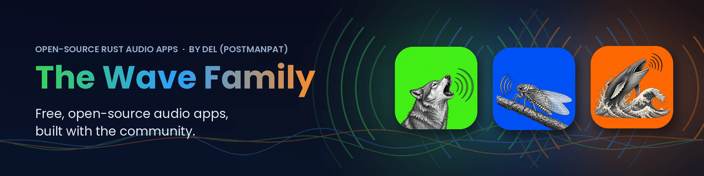
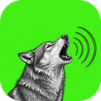
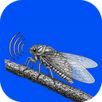
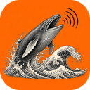

  

## 👋 Hi, I'm Derek

I'm Derek Heasley (aka **postmanpat**). I build free, open-source audio apps in **Rust**, with a lot of help from AI agents. Together they're the **Wave family**: a radio player, a music tracker and a recorder for streamers. All three are free. They get better every time someone tries them and tells me what they think, so come and say hello!

---

## 🌊 The Wave family

<table>
  <tr>
    <td width="96" align="center" valign="top"></td>
    <td valign="top">
      <h3><a href="https://github.com/postmanpat-303/BigWaveRadio">🐺 BigWave Radio</a></h3>
      A free internet radio player that streams thousands of stations from <a href="https://www.radio-browser.info">radio-browser.info</a>, with mood chips, Rhai plugins and a MilkDrop-style visualiser. 
      <b>Platforms:</b> Windows · macOS (universal) · Linux (deb, rpm, Arch, AppImage)  &nbsp;|&nbsp; Rust + egui · MIT 
      <a href="https://github.com/postmanpat-303/BigWaveRadio/releases/latest"><b>⬇ Download v0.9.6</b></a>
    </td>
  </tr>
  <tr>
    <td width="96" align="center" valign="top"></td>
    <td valign="top">
      <h3><a href="https://github.com/postmanpat-303/ChipWaveTracker">🦗 ChipWave Tracker</a></h3>
      An OctaMED-inspired music tracker with a built-in synth, a visual arranger, a mixer with sidechain ducking, MIDI input and WAV/MP3 export. 
      <b>Platforms:</b> Windows (installer or portable zip) · Linux (build from source)  &nbsp;|&nbsp; Rust + egui · GPL-3.0 
      <a href="https://github.com/postmanpat-303/ChipWaveTracker/releases/latest"><b>⬇ Download v0.2.3.5</b></a>
    </td>
  </tr>
  <tr>
    <td width="96" align="center" valign="top"></td>
    <td valign="top">
      <h3><a href="https://github.com/postmanpat-303/StreamWave">🐋 StreamWave</a></h3>
      An audio recorder and editor for streamers and podcasters, with OBS sync, one-click Studio Sound and a rolling buffer so you never miss a take. 
      <b>Platforms:</b> Windows · Linux (AppImage)  &nbsp;|&nbsp; Tauri + Rust · MIT 
      <a href="https://github.com/postmanpat-303/StreamWave/releases/latest"><b>⬇ Download v0.6.0</b></a>
    </td>
  </tr>
</table>

---

## 🤝 Join the community

**These apps are built with you, not just for you.** Ideas, questions, bug reports, screenshots of your setup, songs you made, streams you recorded: it all helps, and I read everything.

| | 💬 Ideas, questions & show-and-tell | 🐞 Feedback |
| --- | --- | --- |
| 🐺 **BigWave Radio** | [Discussions](https://github.com/postmanpat-303/BigWaveRadio/discussions) | [Report a problem](https://github.com/postmanpat-303/BigWaveRadio/issues/new?template=bug_report.yml) · [It works on my system ✅](https://github.com/postmanpat-303/BigWaveRadio/issues/new?template=works_for_me.yml) |
| 🦗 **ChipWave Tracker** | [Discussions](https://github.com/postmanpat-303/ChipWaveTracker/discussions) | [Open an issue](https://github.com/postmanpat-303/ChipWaveTracker/issues/new) |
| 🐋 **StreamWave** | [Discussions](https://github.com/postmanpat-303/StreamWave/discussions) | [Open an issue](https://github.com/postmanpat-303/StreamWave/issues/new) |

> [!TIP]
> **Tried BigWave Radio on a Mac or Linux?** Those builds are brand new and have only been tested on build servers so far. A quick [it works on my system](https://github.com/postmanpat-303/BigWaveRadio/issues/new?template=works_for_me.yml) or [problem report](https://github.com/postmanpat-303/BigWaveRadio/issues/new?template=bug_report.yml) is the most useful thing you can do for the project. Thank you!

**Ways to join in**
- 💡 **Share an idea** for a feature, a theme or a plugin
- ❓ **Ask a question**: there are no silly ones
- 🎨 **Show and tell**: your favourite stations, a ChipWave song, a StreamWave setup, a BigWave plugin
- 🐞 **Report what works and what doesn't** on your system

---

## 🎬 Watch the promos

- 🐺 [BigWave Radio: the wolf finds his pack](https://youtu.be/IxJTYOrA_0c)
- 🐋 [StreamWave: the whale and her calf](https://youtu.be/ZGsCz0rjXeg)
- 📺 More on the channel: [youtube.com/@whatgoesaround1551](https://www.youtube.com/@whatgoesaround1551)

---

## ☕ Support

The Wave apps are free and always will be. If they make your day a little better, you can help keep them going:

  
  

Starring a repo ⭐ and telling a friend helps too. Thanks for stopping by! 🌊
